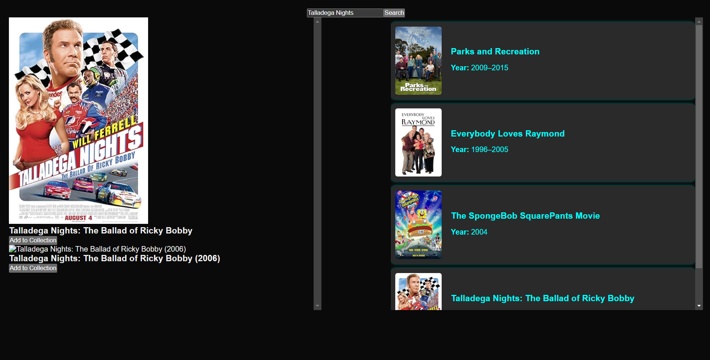

# my-media-manager

A self-hosted manager for a personal movie and TV collection: physical discs
and tapes, the files ripped from them, and a Jellyfin/Plex-style library on a
NAS. It looks titles up on [OMDb](https://www.omdbapi.com/) and
[TMDB](https://www.themoviedb.org/documentation/api), keeps everything in your
own PostgreSQL database, and automates the path from "a file landed in the
ingest folder" to "it is named, filed and linked to its catalog entry".

Built for one household on a home server. There is a single shared passphrase
and no user accounts, so run it on a trusted network (a LAN or a VPN), not on
the open internet.



## Features

- **Catalog** of movies, series, seasons and episodes with OMDb/TMDB lookup.
  The full API payloads are stored, and re-fetching shows a field-by-field
  conflict dialog instead of overwriting your edits.
- **Physical media**: discs, tapes, releases (editions, boxed sets,
  multi-title discs), barcodes, condition, and storage locations (box/binder
  IDs) so you can find an item on the shelf again. Plus a wishlist.
- **Automated ingest**: a watcher on the ingest folder (polling, so SMB/NFS
  shares work) parses filenames, matches them against the catalog and the
  metadata APIs with a confidence score, and moves confident matches into
  `Movies/`, `TV Shows/`, `Documentaries/` and `Live Performances/` with
  Jellyfin-compatible names. Everything else waits in a review queue, with
  extras, alternate versions and episodes handled explicitly.
- **Library inventory and compliance**: a scheduled scan reconciles the
  database with the files on disk (new, moved, missing), probes codecs and
  resolution, and flags naming or layout problems. A mount guard stops an
  unmounted share from being read as an empty library.
- **Disc ripping and tape ingest** screens (`/admin/disc-ripper`,
  `/admin/tape-ingest`). Ripping is done by the companion disc-ripper-service.
- **Poster cache** on a persistent volume, so artwork keeps working offline.
- **Stats and an "attention" list** of things that need a decision.
- **Mobile API** (bearer tokens) for the companion phone app, including a
  "scan cover" step that reads a case photo with a local vision model.
- **Observability**: a Prometheus `/metrics` endpoint and a
  [Grafana dashboard](docs/grafana/README.md).

## Stack

| Layer | Technology |
|---|---|
| Frontend | Next.js 15 (App Router, TypeScript), MUI, Zustand |
| Backend | Python 3.11, FastAPI (async), SQLAlchemy, Alembic |
| Database | PostgreSQL 16 |
| Auth | HTTP-only session cookie + bcrypt passphrase; bearer tokens for mobile |
| Deploy | Docker Compose |

## Quick start (Docker Compose)

You need Docker with Compose v2.24 or newer.

```bash
git clone https://github.com/colinmarley/my-media-manager.git
cd my-media-manager
cp .env.example .env
```

Edit `.env`. At minimum, set:

- `POSTGRES_PASSWORD`: URL-safe characters only, e.g. `openssl rand -hex 24`.
- `APP_DEFAULT_PASSWORD`: the passphrase you will log in with. It is only
  used to seed an empty database; change it later in Settings.
- `MEDIA_ROOT`: the host folder holding your media. The default `./media`
  works for a first try. Point it at your NAS mount later.
- Optional: `MEDIA_LIBRARY_OMDB_API_KEY` / `MEDIA_LIBRARY_TMDB_API_KEY` (and
  the `NEXT_PUBLIC_*` copies) for metadata lookups. Free keys are available
  from both services. The free OMDb tier allows 1,000 requests a day.

`DISC_RIPPER_URL` and `LOCALAI_URL` must be set, but the placeholders are fine
if you do not run those companions. The screens that use them report the
service as unreachable.

Then create the media folders, build the database schema once, and start the
stack:

```bash
mkdir -p media/ingest media/jellyfin
docker compose config >/dev/null          # names any missing required variable
docker compose up -d postgres --wait
docker compose run --rm -e MIGRATE_ON_START=false backend python scripts/init_schema.py
docker compose up -d --build
```

The schema step is needed only on a brand-new database: the first Alembic
revision expects existing tables. Afterwards the backend's entrypoint runs
`alembic upgrade head` on every start.

- Web app: <http://localhost:3010> (`FRONTEND_PORT`)
- API docs: <http://localhost:8082/docs> (`BACKEND_PORT`)

Drop a video file into `media/ingest/` and it shows up in the ingest queue.
To start the watcher automatically, keep
`MEDIA_LIBRARY_INGRESS_AUTO_START_WATCHER=true`.

### Media layout

Inside the container the media root is always mounted at `/ark/media`. That
path is stored in the database, so keep it fixed and change only `MEDIA_ROOT`
on the host:

```
$MEDIA_ROOT/            ->  /ark/media/
  ingest/               ->  new files land here (watched)
  jellyfin/             ->  the library root (JELLYFIN_DEST_BASE)
    Movies/  TV Shows/  Documentaries/  Live Performances/
  home-videos/  tape-archive/  catalog-images/
```

Point Jellyfin or Plex at `$MEDIA_ROOT/jellyfin`. For a NAS share, mount it on
the host (an fstab CIFS entry with `x-systemd.automount` survives NAS
reboots) and set `MEDIA_ROOT` to the mount point. Path rules and why they
matter are in [docs/architecture/STORAGE_AND_HOSTS.md](docs/architecture/STORAGE_AND_HOSTS.md).

## Optional companions

| Project | What it adds | How it connects |
|---|---|---|
| [media-manager-mobile](https://github.com/colinmarley/media-manager-mobile) | An Expo phone app for cataloguing discs and tapes while you sort: barcode scan, cover photo, storage location, rip status. | Talks to the backend on port 8082 with a bearer token (log in with the same passphrase). |
| [disc-ripper-service](https://github.com/colinmarley/disc-ripper-service) | Rips discs on the machine with the optical drive and delivers the files into the ingest folder. | `DISC_RIPPER_URL`. The frontend proxies `/api/disc-ripper/*` to it, and it calls the backend to link rips to catalog entries. It must see the media share at the same `/ark/media` path. |
| [LocalAI](https://localai.io/) | A local vision model for the mobile "scan cover" step. | `LOCALAI_URL`, `MEDIA_LIBRARY_LOCALAI_API_KEY`. |

The end-to-end workflow across the apps is described in
[docs/guides/COLLECTION_CATALOGUING_WORKFLOW.md](docs/guides/COLLECTION_CATALOGUING_WORKFLOW.md).
For an example of the stack split across several machines, see
[docs/homelab-deploy.md](docs/homelab-deploy.md).

## Local development

Prerequisites: Node.js 20+, Python 3.11+, Docker (for Postgres), and
optionally `make`.

```bash
npm ci                                       # frontend
cd backend && python3 -m venv venv && source venv/bin/activate   # Windows: venv\Scripts\activate
pip install -r requirements-dev.txt && cd ..

cp .env.example .env                         # compose / dev database
cp .env.local.example .env.local             # `npm run dev` (BACKEND_URL, browser keys)
cp backend/.env.example backend/.env         # uvicorn outside Docker (DATABASE_URL, paths, keys)

make dev-db                                  # Postgres on 127.0.0.1:5432
cd backend && python scripts/init_schema.py  # first time only (new database)
python scripts/seed_password.py              # first time only: set the passphrase
uvicorn main:app --reload --port 8082        # API on :8082
cd .. && npm run dev                         # web app on http://localhost:3000
```

Outside Docker, set the media paths in `backend/.env`
(`MEDIA_LIBRARY_INGRESS_DEFAULT_PATHS`, `JELLYFIN_DEST_BASE`,
`MEDIA_LIBRARY_NAS_MOUNT_CHECK_PATH`) to real folders on your machine.
`backend/config/settings.py` lists every setting. Each one can be set as
`MEDIA_LIBRARY_<NAME>`.

## Tests

| Suite | Command | Needs |
|---|---|---|
| Frontend unit (vitest) | `npm test` (or `make test-frontend`) | nothing |
| Backend unit (pytest) | `cd backend && python -m pytest tests/` (or `make test-backend`) | nothing; DB-backed tests are skipped |
| Backend integration | `make test-integration` | Docker: throwaway Postgres on 127.0.0.1:55433, in RAM |
| Release/catalog tests | `make test-releases` | Docker |
| Lint | `npm run lint` | nothing |
| End-to-end smoke (Playwright) | `BASE_URL=... E2E_PASSWORD=... npm run test:e2e:smoke` | a running stack |

The test suite cannot reach the production database: `backend/tests/conftest.py`
points `DATABASE_URL` at the isolated test database before any app module is
imported. Details are in [docs/guides/TESTING.md](docs/guides/TESTING.md).

## Secrets and configuration

- Real values belong only in `.env`, `.env.local` and `backend/.env`. All
  three are git-ignored, as are service-account, credential and key files.
- The tracked templates are `.env.example` (Compose), `.env.local.example`
  (Next.js dev) and `backend/.env.example` (backend outside Docker). They
  hold placeholders only.
- `NEXT_PUBLIC_*` keys are compiled into the browser bundle, so treat them as
  public.
- If a secret is ever committed, rotate it. Removing it from history is not
  enough.

## More documentation

[docs/README.md](docs/README.md) indexes the architecture notes, API
reference (`docs/api/endpoints.md`), guides and implementation logs. Some of
the later material, such as poster caching, metadata conflict handling and
file reassignment, is covered in more depth there.

## License

[MIT](LICENSE) © 2024-2026 Colin Marley
